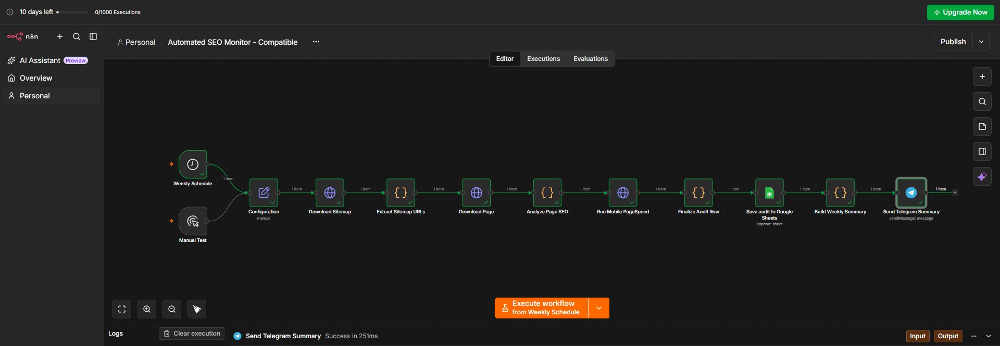
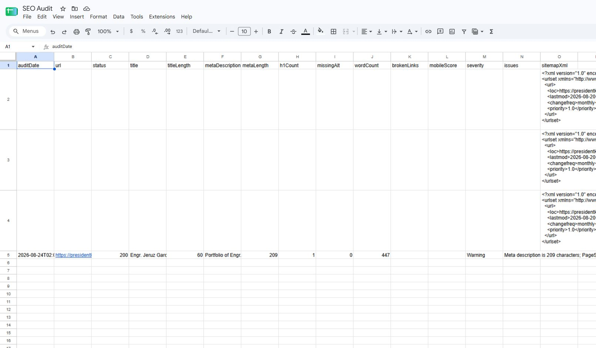
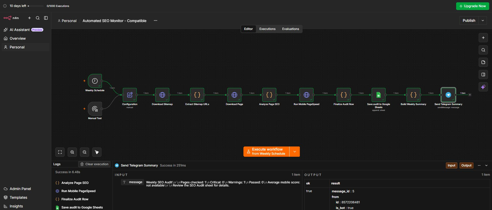
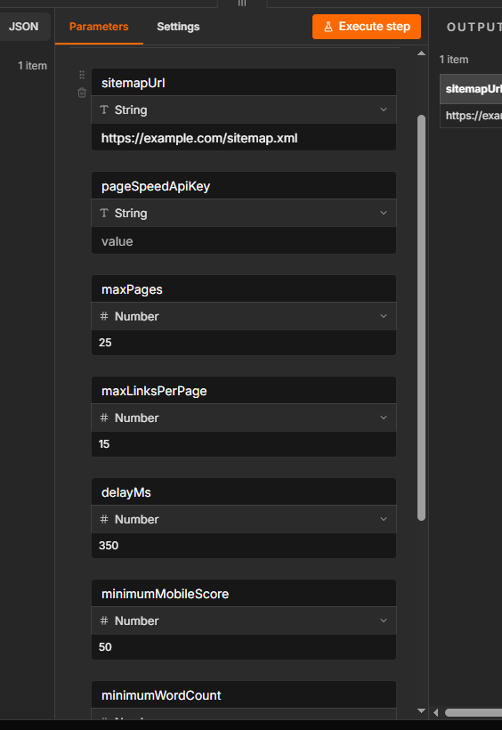
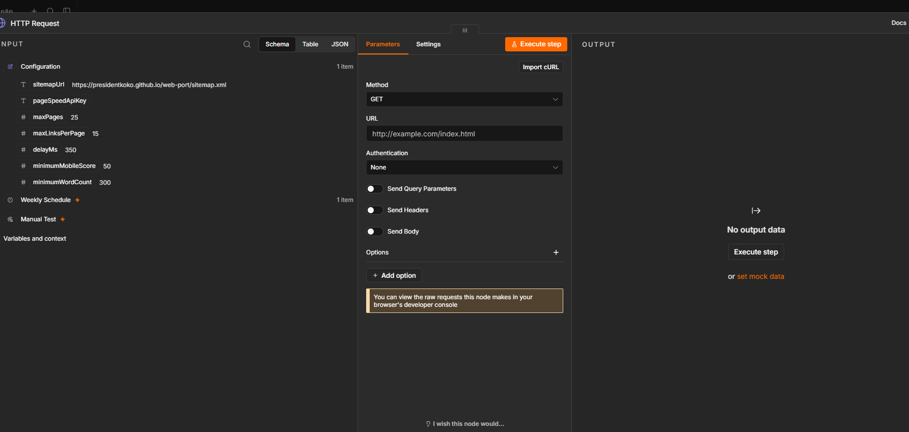

# Automated SEO Monitoring System

An n8n Community Edition workflow that reads a website sitemap, audits essential on-page SEO signals, records page-level findings in Google Sheets, and sends a scheduled summary through Telegram.


## End-to-end proof

The following screenshots come from a successful live run of the packaged workflow. Every node completed, the audit row reached Google Sheets, and Telegram accepted the weekly summary.

### Completed n8n execution



### Google Sheets audit result



### Telegram delivery result



## What it does

- Runs manually or every Monday at 08:00.
- Downloads `sitemap.xml` with an n8n HTTP Request node.
- Audits every discovered page up to a configurable limit.
- Checks HTTP status, title, meta description, H1 count, image alt text, and word count.
- Retrieves the Google PageSpeed Insights mobile performance score.
- Classifies findings as `Critical`, `Warning`, or `Pass`.
- Appends one audit row per page to Google Sheets.
- Sends a weekly result summary to Telegram.

The workflow uses dedicated HTTP Request nodes because network globals such as `fetch` and `AbortController` are not available in every n8n Code-node runtime.

## Workflow

```text
Weekly Schedule / Manual Test
              ↓
         Configuration
              ↓
       Download Sitemap
              ↓
     Extract Sitemap URLs
              ↓
         Download Page
              ↓
       Analyze Page SEO
              ↓
    Run Mobile PageSpeed
              ↓
      Finalize Audit Row
              ↓
       Google Sheets
              ↓
      Telegram Summary
```

## SEO rules

| Rule | Severity |
| --- | --- |
| HTTP status is not 200 | Critical |
| Missing page title | Critical |
| Title longer than 60 characters | Warning |
| Missing meta description | Warning |
| Meta description longer than 160 characters | Warning |
| Missing H1 | Critical |
| Multiple H1 headings | Warning |
| Images missing alt text | Warning |
| Word count below configured minimum | Warning |
| Mobile PageSpeed below configured minimum | Warning |

## Requirements

- n8n Community Edition
- Google account and Google Sheets credential
- Telegram bot and Telegram credential
- Website sitemap
- Optional Google PageSpeed Insights API key

## Installation

1. Download `seo-monitor-workflow.json`.
2. In n8n, select **Import from File** and choose the workflow JSON.
3. Open **Configuration** and set the sitemap URL and audit thresholds.
4. Connect the Google Sheets and Telegram credentials.
5. Run **Manual Test** before enabling the weekly schedule.

## Configuration



| Field | Example | Purpose |
| --- | --- | --- |
| `sitemapUrl` | `https://example.com/sitemap.xml` | Sitemap to audit |
| `pageSpeedApiKey` | blank or API key | Optional PageSpeed authentication |
| `maxPages` | `25` | Maximum pages per run |
| `minimumMobileScore` | `50` | PageSpeed warning threshold |
| `minimumWordCount` | `300` | Thin-content warning threshold |

Only crawl websites you own or are authorised to test. Start with a small page limit.

## HTTP Request setup

The sitemap and pages are downloaded through n8n HTTP Request nodes rather than inside JavaScript.



The sitemap request URL uses this expression:

```text
{{ $json.sitemapUrl }}
```

Its response format is **Text** with **Full Response** enabled.

## Google Sheets setup

Create a spreadsheet named `SEO Monitoring Report` and rename the first tab to `SEO Audit`.

Paste this exact header row into cell `A1`:

```text
auditDate	url	status	title	titleLength	metaDescription	metaLength	h1Count	missingAlt	wordCount	mobileScore	severity	issues
```

In **Save audit to Google Sheets**:

1. Select the spreadsheet and `SEO Audit` tab.
2. Choose **Append Row**.
3. Set column mapping to **Map Automatically by Column Name**.

## Telegram setup

1. Create a bot with Telegram's `@BotFather`.
2. Add the token as an n8n Telegram credential. Never commit the token.
3. Start a private chat with the bot and obtain the user's numeric Chat ID.
4. Set that number in **Send Telegram Summary**.
5. Keep the message expression as `{{ $json.message }}`.

## Security

The repository contains no API keys, Telegram tokens, Google credentials, spreadsheet IDs, or personal Chat IDs. Configure secrets through n8n's credential manager.

## Current scope

This release audits page-level metadata, headings, image alt coverage, word count, status, and mobile performance. Broken-link crawling can be added as a separate rate-limited sub-workflow so it does not multiply requests during the primary audit.

## Portfolio summary

> I developed an automated SEO monitoring system that crawls website pages, detects on-page and technical SEO issues, records results, and sends scheduled reports.

## License

MIT
