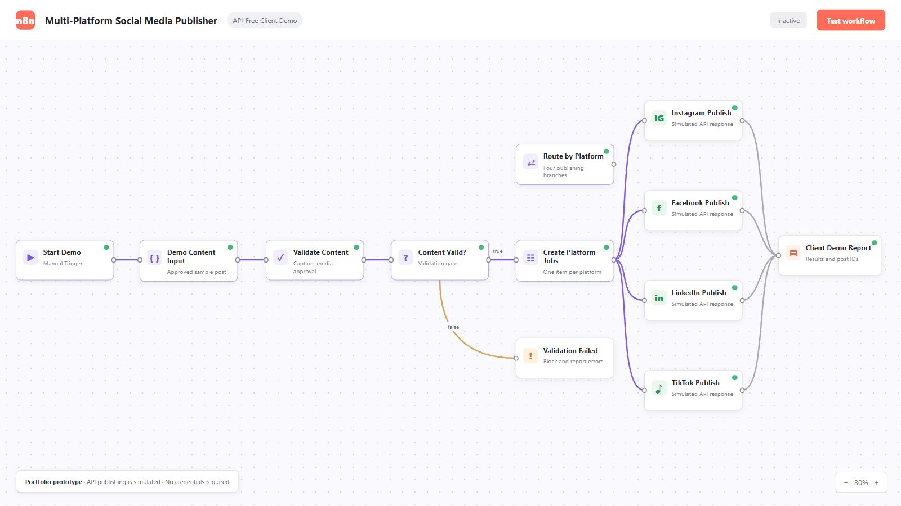

# Multi-Platform Social Media Publisher (API-Free Demo)

An importable n8n portfolio workflow that demonstrates how one approved content item can be validated, adapted, routed, and logged for Instagram, Facebook, LinkedIn, and TikTok.

This is intentionally an API-free prototype. It does not publish live content and does not require credentials. Each platform node returns a realistic simulated publishing result that can later be replaced with the platform's official API node or an HTTP Request node.

## What the demo proves

- Content validation before publishing
- Platform-specific caption formatting
- Four-way workflow routing
- Simulated publishing responses and post IDs
- A consolidated execution report
- Clear failure handling for incomplete content

## Run it

1. In n8n, select **Import from File**.
2. Import `social-media-publishing-demo.json`.
3. Open **Demo Content Input** to change the sample post if desired.
4. Select **Test workflow**.
5. Inspect **Client Demo Report** for the final result.

No credentials or external services are needed. The workflow uses a Manual Trigger so it works on a local n8n installation during a client presentation.

## Demo scenarios

The included workflow starts with a valid post. To demonstrate validation, delete the `baseCaption` or `mediaUrl` value in **Demo Content Input**, then run it again. The invalid item will go to **Validation Failed**, and no simulated platform publishing will occur.

The accompanying `demo-content.csv` can be imported into Google Sheets if you want to show a content-calendar interface. It is not required to execute the workflow.

## Suggested presentation

1. Show the content entering the workflow.
2. Explain the validation gate.
3. Open each platform node and show how the caption changes.
4. Run the workflow.
5. Show the four simulated post IDs and final success summary.

Suggested portfolio description:

> Designed an API-ready n8n publishing workflow that validates approved content, creates platform-specific versions, routes posts to four social networks, and consolidates publishing results. The portfolio edition uses simulated API responses so clients can review the complete automation logic without sharing account credentials.

## Moving from demo to production

Replace each `Simulate ... Publish` Code node with the relevant official integration. Preserve the normalized result fields (`platform`, `status`, `postId`, `publishedAt`, and `caption`) so the reporting step continues to work.

For real scheduled publishing, n8n must run continuously on n8n Cloud, a VPS, or another always-on computer. Official platform permissions and account requirements still apply.
